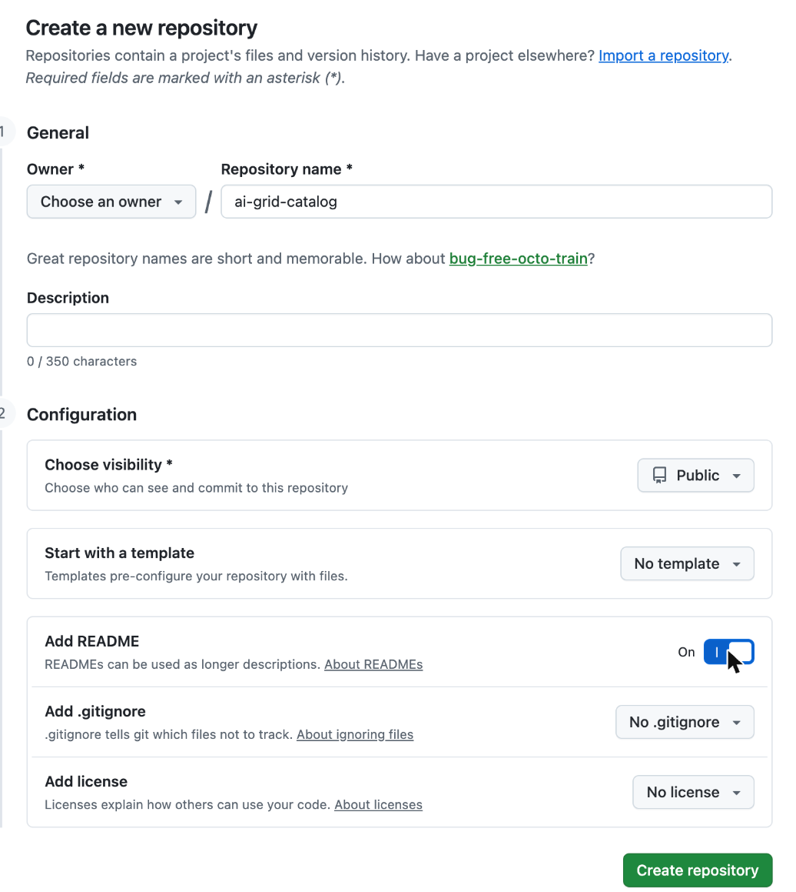

> **Prototype:** this template pins [`cfchase/ai-grid-cluster-gitops`](https://github.com/cfchase/ai-grid-cluster-gitops)
> branch `proto/library-v2` until the library lands upstream.

# AI Grid deployment template

A GitHub template for an AI Grid **deployment repository**: the components one hub runs, its inputs, and its sites'
files. It installs from the component library
[`cfchase/ai-grid-cluster-gitops`](https://github.com/cfchase/ai-grid-cluster-gitops) at one pinned commit. Tested end
to end on 2026-11-10 ([the example deployment](docs/install/appendix-b-example.md)).

## Start here

1. Create two repositories on GitHub, both public:

   - **Your deployment repository,** from this template: click **Use this template** > **Create a new repository**,
     choose the owner, and name it, such as `ai-grid-deployment`.

     
     

   - **Your catalog repository,** empty: [create a new repository](https://github.com/new), name it, such as
     `ai-grid-catalog`, and turn on **Add README**. The hub delivers the models and subscriptions in it to your sites,
     and the provider console writes them there.

     

   The hub's Argo CD reads both. This guide was tested with public repositories and doesn't cover the credentials
   that private ones need. With the GitHub CLI, the same two repositories are:

   ```sh
   gh repo create OWNER/DEPLOYMENT_REPO --template ai-grid-cloud/ai-grid-deployment-template --public
   gh repo create OWNER/CATALOG_REPO --add-readme --public
   ```

2. Follow the [install guide](docs/install/README.md) in your new repository.
