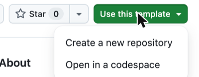
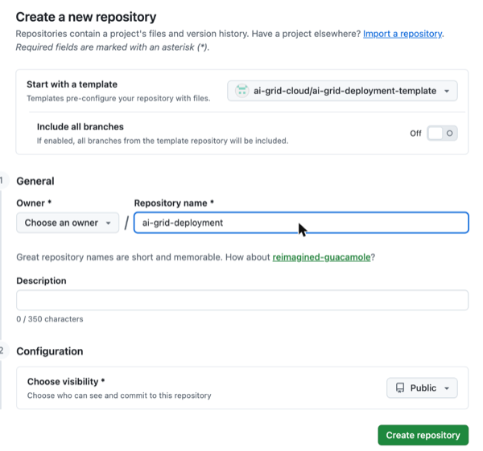

> **Prototype:** this template pins [`cfchase/ai-grid-cluster-gitops`](https://github.com/cfchase/ai-grid-cluster-gitops)
> branch `proto/library-v2` until the library lands upstream.

# AI Grid deployment template

A GitHub template for an AI Grid **deployment repository**: the components one hub runs, its inputs, and its sites'
files. It installs from the component library
[`cfchase/ai-grid-cluster-gitops`](https://github.com/cfchase/ai-grid-cluster-gitops) at one pinned commit. Tested end
to end on 2026-11-10 ([the example deployment](docs/install/appendix-b-example.md)).

## Start here

1. Create your deployment repository from this template:

   1. Click **Use this template** > **Create a new repository**.

      

   2. Choose the owner, name it, such as `ai-grid-deployment`, keep **Public**, and click **Create repository**. The
      hub's Argo CD reads it; this guide was tested with public repositories and doesn't cover the credentials that
      private ones need.

      

   With the GitHub CLI instead:
   `gh repo create OWNER/DEPLOYMENT_REPO --template ai-grid-cloud/ai-grid-deployment-template --public`.

2. Follow the [install guide](docs/install/README.md) in your new repository.
