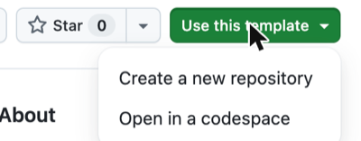
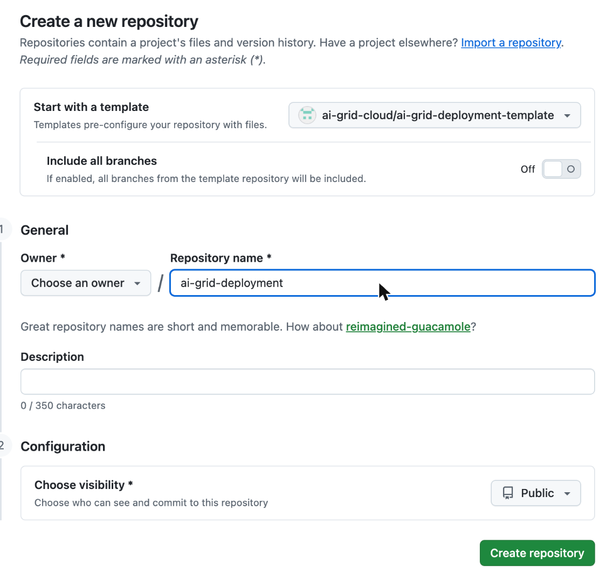

> **Prototype:** this template installs
> [`ai-grid-cloud/ai-grid-cluster-gitops`](https://github.com/ai-grid-cloud/ai-grid-cluster-gitops) from its `main`
> branch, with no changes to the library. By default your hub follows `main`; to pin one commit instead, see
> [Follow the library or pin it](#follow-the-library-or-pin-it). For what the library's `main` branch can't do yet,
> see [the limits of `main`](docs/upstream-main-limits.md).

# AI Grid deployment template

A GitHub template for an AI Grid **deployment repository**. You create your own repository from it, and your hub's
Argo CD installs AI Grid from that repository:

- **On the hub:** ACM, the grid, the MaaS database and Redis, the library's Keycloak for tenants, and the provider
  console.
- **On each site:** OpenShift AI with MaaS and the grid, in the role you choose when you add it in the provider console.

The template carries choices tested end to end on 2026-11-10, so you change only your names.

## The three repositories

| Repository | What it holds | Who changes it |
|---|---|---|
| Library, [`ai-grid-cloud/ai-grid-cluster-gitops`](https://github.com/ai-grid-cloud/ai-grid-cluster-gitops) | The components (Argo CD applications, ACM policies, charts) and their reference docs | Its maintainers; you follow its `main` branch, or pin one commit, and don't edit it |
| Your deployment repository, from this template | The library revision, which components run, your inputs, the install guide and its scripts | You |
| Your catalog repository, created in the install guide | Models and subscriptions | The provider console |

The hub's Argo CD reads all three. Your deployment repository names the library revision in
`root/applicationset.yaml`, which comes from the template, and your repositories, the catalog among them, in
`root/inputs.env`, which is yours and which the template doesn't have. For more, see the library's
[getting started](https://github.com/ai-grid-cloud/ai-grid-cluster-gitops/blob/a3c63a980d3130a81af0b367039b547c5c738f22/docs/acm/README.md).

## Follow the library or pin it

`libraryRevision` in `root/applicationset.yaml` is the library revision your hub reads. It's one of the following:

- **A branch, `main` by default.** The hub follows the branch: when the library's `main` moves, Argo CD updates
  your clusters on its own, with nothing for you to do.
- **A commit.** The hub stays at that commit until you change it. Pin a commit when you want to choose when your
  clusters change, such as to test a library commit before production runs it, or to hold a known-good install
  while `main` moves on.

To set it, set `LIBRARY` under `options:` in `.config/clusters.yaml` to a branch, a tag or a full 40-character SHA,
and run `make install`; or run the script yourself, then commit and push `root/applicationset.yaml`:

```sh
scripts/set-library.sh REVISION
```

A branch is written as its name, so the hub follows it. A tag or a SHA is written as the commit's SHA, so the hub
stays there. To follow `main` again, set `LIBRARY: main`, or run `scripts/set-library.sh main`.

A pin holds every Application the root generates. The library's own ApplicationSets still read the library's
default branch, whatever you pin ([limits of `main`, L1](docs/upstream-main-limits.md#l1-the-librarys-own-applicationsets-read-head)).

## Start here

1. Create your deployment repository from this template:

   1. Click **Use this template** > **Create a new repository**.

      

   2. Choose the owner, name it, such as `ai-grid-deployment`, keep **Public**, and click **Create repository**. The
      hub's Argo CD reads it; this guide was tested with public repositories and doesn't cover the credentials that
      private ones need.

      

   With the GitHub CLI instead:

   ```sh
   gh repo create OWNER/DEPLOYMENT_REPO --template ai-grid-cloud/ai-grid-deployment-template --public
   ```

2. Choose how to install:

   - To install the hub and import your sites with one unattended command, such as for a test suite or a CI job,
     follow [Install with one command](docs/install/09-hands-off.md).
   - To install page by page, follow the [install guide](docs/install/README.md).

## Update from the template

Your repository doesn't follow the template by itself. To pick up the template's later fixes, merge them in from
your repository's directory:

```sh
make update
```

It refuses to run while you have uncommitted changes. The first time, it finds the template commit your repository
started from, so git merges only what changed on each side since then. It never pushes. After the merge it runs
the same check as `make check`; if it fails, it says `DON'T PUSH` and you fix what the check names first.

If your repository still has `root/inputs.yaml`, which the template replaced with `root/inputs.env`, `make update`
stops on a conflict in that file and prints the commands that move your values and finish the merge.

The library revision follows the same rule as any other template line:

- If your `libraryRevision` equals the template's earlier one, whether you never changed it or set the same commit,
  the update takes the template's, which follows the library's `main` branch. When that moves you from a pinned
  commit to a branch, `make update` says so and prints the `scripts/set-library.sh` command that keeps your pin.
- If you set a different one, with `LIBRARY` or `scripts/set-library.sh`, the update never replaces it: it stops on
  a conflict on that line. Keep your line to stay at your pin, or take the template's to follow `main`.
- If `LIBRARY` under `options:` in your `clusters.yaml` names another revision than the merged one, `make update`
  says so: the next `make install` writes `LIBRARY`'s value.

Review the merge and push:

```sh
git diff ORIG_HEAD
git push
```

If a file changed on both sides, it stops and names the file. Keep your values and the template's other changes in
it, then run `git add FILE` and `git commit`, or undo the merge with `git merge --abort`.
