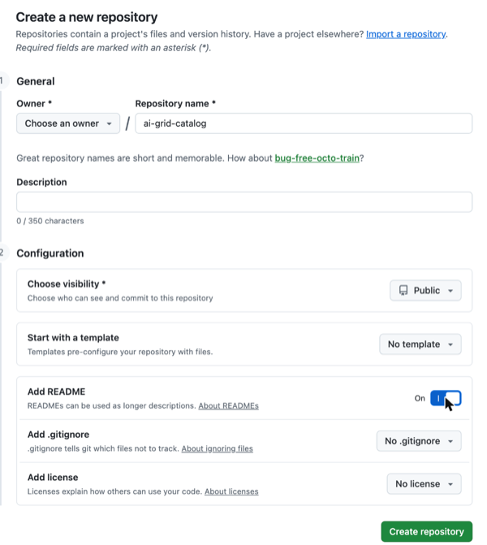
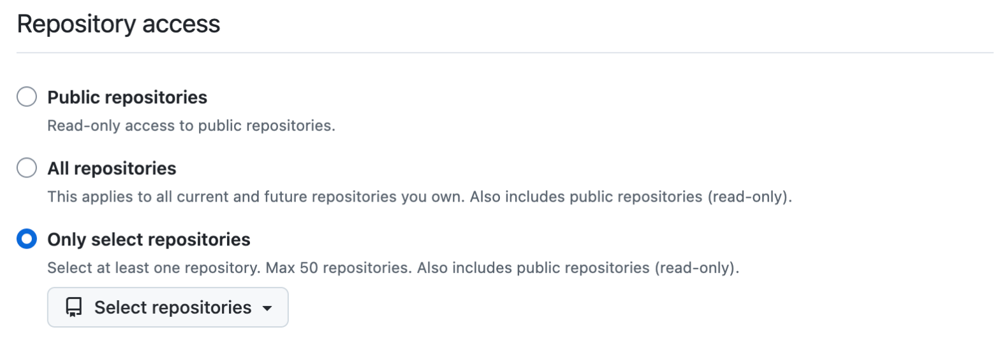
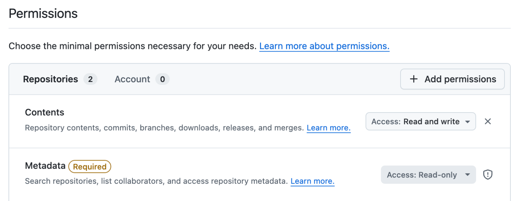

# Set up your deployment repository

Your deployment repository starts with the template's tested choices. On this page you create your catalog
repository, set the names that must be yours, check the result, and push it.

If you're reinstalling with your existing repositories, skip cloning, naming your clusters and
[creating your catalog repository and its token](#2-create-your-catalog-repository-and-its-token). From your
deployment repository's directory, log in ([part 1, step 3](#1-clone-your-repository-and-log-in-to-your-clusters)), check your
prerequisites ([part 3](#3-check-your-prerequisites)), then do parts 4 and 5. Every command in them is safe to run
again.

## 1. Clone your repository and log in to your clusters

1. Clone your deployment repository:

   ```sh
   git clone https://github.com/OWNER/DEPLOYMENT_REPO.git && cd DEPLOYMENT_REPO
   ```

   Replace `OWNER/DEPLOYMENT_REPO` with your deployment repository. Run every command in this guide from the
   `DEPLOYMENT_REPO` directory.

   Your deployment repository must be public. The hub's Argo CD reads it with no login, and private repositories
   aren't supported. To make an existing repository public, run
   `gh repo edit OWNER/DEPLOYMENT_REPO --visibility public --accept-visibility-change-consequences`.

2. Name your clusters. Copy the example file:

   ```sh
   cp clusters-example.yaml clusters.yaml
   ```

   In `clusters.yaml`, replace each `REQUIRED-` value: the hub's API URL, and the site's name and API URL. The file
   says only how to reach each cluster: you choose the site's role and location when you add it to the grid in the
   provider console, on page 6. The guide calls the hub `hub`. Leave the
   `catalog:` and `options:` sections as they are: they're for `make install`, and these pages name the catalog
   with `make inputs CATALOG=` instead. To find a cluster's API URL, open its web console, click your user name >
   **Copy login command**, and read the `--server=` value, or take it from the cluster installer's output. For example:

   ```yaml
   apiVersion: ai-grid.dev/v1alpha1
   kind: Clusters
   hub:
     api: https://api.hub.example.com:6443
   sites:
     - name: site-east-1
       api: https://api.site-east-1.example.com:6443
   ```

   The site's name is a DNS label. It becomes the site's ACM cluster name, and you can't change it once the site is
   imported. Commit `clusters.yaml` with your other changes in part 5; it records which clusters make up your grid,
   and holds no secrets: the scripts refuse a `token`, `username` or `password` on the hub or a site,
   `catalog.token`, and the `deployment:` and `quay:` sections. Leave `catalog.url` as `REQUIRED-catalogRepoURL` on
   these pages: a real URL there turns off the page-by-page defaults for the catalog token and the quay.io login. A file in the old format,
   with `credentials:`, `repositories:`, `github:`, a `kubeconfig` key, `hub.name`, or a `role` or `location` on a
   site, stops with a message that says what to change. A `maasCertificate` on a site stops the same way: a site's
   MaaS gateway keeps the cluster's internal certificate ([limits of `main`](../upstream-main-limits.md#l5-the-maas-gateway-presents-the-cluster-internal-certificate)).
   This guide keeps that committed file. If a private `.config/clusters.yaml` exists, from
   [Install with one command](09-hands-off.md), the scripts read it instead.

3. Log in to each cluster as a `cluster-admin` user:

   ```sh
   make login
   ```

   For each cluster in `clusters.yaml`, it runs `oc login --web` against the cluster's API URL, which opens your
   browser, and saves the login in `.config/NAME/kubeconfig`, which git ignores. Your own kubeconfig isn't touched.
   Clusters you're still logged in to are skipped. When one login expires later, run `make login` again, or
   `make login NAME=hub` for one cluster. To use a kubeconfig you already have instead, such as the installer's
   `auth/kubeconfig`, copy it to `.config/NAME/kubeconfig`. If `make login` stops with a certificate problem, see
   [an untrusted cluster certificate](09-hands-off.md#an-untrusted-cluster-certificate).

## 2. Create your catalog repository and its token

The catalog repository holds your models and subscriptions: the hub delivers them to your sites, and the provider
console writes them there with a token that can write only this repository.

1. [Create a new repository](https://github.com/new): name it, such as `ai-grid-catalog`, make it public, and turn on
   **Add README**. The catalog repository must be public: the hub's Argo CD reads it with no login, and private
   repositories aren't supported. The catalog token is only for the provider console, which writes to it.

   

   With the GitHub CLI instead:

   ```sh
   gh repo create OWNER/CATALOG_REPO --add-readme --public
   ```

2. Create the catalog token. The provider console writes your models and subscriptions with it.

   1. Open [New fine-grained personal access token](https://github.com/settings/personal-access-tokens/new). You can
      also reach it from your profile picture: **Settings** > **Developer settings** > **Personal access tokens** >
      **Fine-grained tokens** > **Generate new token**.
   2. Fill in the form:
      - **Token name:** `ai-grid-catalog`
      - **Expiration:** **90 days**, or a later **Custom** date if your organization allows one. When it expires,
        the console can't save models or subscriptions until you replace it, so note the date.
      - **Description:** optional, such as `AI Grid console writes the catalog`
      - **Resource owner:** your account, or the organization that owns your catalog repository. If that
        organization requires approval for fine-grained tokens, the token can only read until an organization owner
        approves it.
      - **Repository access:** **Only select repositories**, then open **Select repositories** and choose your
        catalog repository, and only that one.
      - **Permissions:** on the **Repositories** tab, click **Add permissions**, select **Contents**, and set it to
        **Access: Read and write**. GitHub adds **Metadata: Read-only** itself.
      - **Everything else:** no access. Add no other repository permission and no **Account** permission.

      

      

   3. Click **Generate token** at the bottom of the form.
   4. Copy the token from the page that follows. GitHub shows it only once.

3. Save the token to a file outside your repository that only you can read, and never commit it:

   ```sh
   mkdir -p ~/.ai-grid && (umask 077 && printf 'Paste the token: ' && read -rs t && printf '%s' "$t" > ~/.ai-grid/catalog-token && echo)
   ```

   It asks for the token without showing it, and writes it to `~/.ai-grid/catalog-token`, readable only by you. Paste
   the token and press Enter. You use it in
   [install the hub components](04-hub-components.md#1-create-the-consoles-secrets).

## 3. Check your prerequisites

Check your tools, each cluster in `clusters.yaml`, your registry logins and your catalog token:

```sh
make prereqs
```

It reads your registry logins from `~/.config/containers/auth.json`, or from `$XDG_RUNTIME_DIR/containers/auth.json`
when that's where `podman login` saved them, and your catalog token from `~/.ai-grid/catalog-token`. To use another
auth file, add `QUAY_AUTH_FILE=AUTH_FILE`. It also fetches the library at your library revision into `.library/`,
which git ignores; the scripts in `scripts/` use it. It changes nothing on your clusters and never blocks. The output
is similar to the following:

```text
Tools
ok       oc                               4.22.17
MISSING  clusteradm                       imports the site into ACM
...
Registry logins (pre-release builds)
ok       auth file                        /home/user/.config/containers/auth.json
ok       quay.io/rhoai login              quay.io/rhoai entry
ok       registry.stage.redhat.io login   entry present (model runtime images)
...
Hub hub
ok       reachable                        https://api.hub.example.com:6443
ok       OpenShift 4.21 or later          4.22.18
...
Site site-east-1
ok       reachable                        https://api.site-east-1.example.com:6443
...
Catalog token
ok       catalog token file               /home/user/.ai-grid/catalog-token (mode 600, not empty)

23 ok, 1 missing
Nothing was changed; fix these before the page that needs them.
```

Install any tool marked `MISSING` before you continue.

## 4. Set your names

Set the values that name your repositories:

```sh
make inputs CATALOG=CATALOG_REPO_URL
```

Replace `CATALOG_REPO_URL` with your catalog repository's URL, such as
`https://github.com/my-org/ai-grid-catalog.git`. It reads no cluster. It prints each value it sets, and then runs
`make check`:

| File | Value | Set to |
|---|---|---|
| `root/inputs.env` | `deploymentRepoURL` | Your deployment repository's URL, from `git remote get-url origin` |
| `root/inputs.env` | `deploymentRevision`, `catalogRevision` | `main` |
| `root/inputs.env` | `catalogRepoURL` | `CATALOG_REPO_URL` |
| `root/inputs.env` | `keycloakOverlay` | `core` |
| `root/inputs.env` | `hubCertManager` | `library` |
| `hub/catalog/*.yaml` | The catalog's repository and revision | `catalogRepoURL` and `catalogRevision` from `root/inputs.env` |

`root/inputs.env` is yours: the template doesn't have it, so `make update` never changes it.
`root/kustomization.yaml` copies its values over the root's `REQUIRED-` placeholders; leave those. A value that's
already set is kept, so you can run `make inputs` again. `hub/catalog/` always follows `root/inputs.env`: each run
rewrites it from that file. If `root/inputs.env` still has inputs the root no longer reads, such as `idpIssuerURL` or
`portalRedirectURI`, `make inputs` removes them and prints a `removed` line for each.

Then check that the hub can read both repositories with no login:

```sh
make prereqs
```

Now that `root/inputs.env` names them, it runs an anonymous `git ls-remote` of each and prints an `ok` or `FAIL` line
for `deployment repository` and `catalog repository` under **Repositories the hub reads**. A `FAIL` that says
`is private or doesn't exist` means the repository is private, or its URL is wrong: make it public with
`gh repo edit OWNER/REPO --visibility public --accept-visibility-change-consequences`.

`keycloakOverlay` chooses what the library's Keycloak, the tenants' identity provider on the hub, starts with.
Choose it now, before your first push:

| Deployment | `keycloakOverlay` |
|---|---|
| A test deployment | `default` |
| Production | `core` |

- `core`: the `saas` broker realm only, with no example organizations and no test users. Use it for every real
  install. Tenants sign in through an organization's own identity provider, which you link in the provider console.
- `default`: adds the library's example organizations and their test users
  ([Keycloak install profiles](https://github.com/ai-grid-cloud/ai-grid-cluster-gitops/blob/a3c63a980d3130a81af0b367039b547c5c738f22/apps/keycloak/README.md#install-profiles)).
  Use it only for a test deployment, never for a real one: anyone who knows the test users' passwords can sign in.

To use `default`, set `keycloakOverlay=default` in `root/inputs.env` before you
[commit and push](#5-commit-and-push). `make inputs` keeps a value that's already set.

Changing `keycloakOverlay` from `core` to `default` after the hub has installed Keycloak doesn't add the example
organizations: Keycloak creates them only when it first imports realm `saas`. You get the example realms, but the
provider console can't create organizations that use their identity providers. To switch then, you
[re-import realm `saas`](troubleshooting.md#example-organizations-are-missing-after-switching-keycloakoverlay-to-default),
which deletes every organization, user and session in it (test deployments only). `make inputs` and `make install` stop when `root/inputs.env` says `default`
and the branch you pushed says `core`. If the hub hasn't installed Keycloak yet, or you'll re-import realm `saas`,
run the command again with `KEYCLOAK_OVERLAY_CHANGE=1`, such as `make inputs KEYCLOAK_OVERLAY_CHANGE=1`.

`hubCertManager` chooses which cert-manager the hub runs:

- `library`: the hub installs the library's cert-manager, as upstream's root does. Use it on a hub that doesn't
  run cert-manager yet.
- `platform`: the hub already runs the platform's cert-manager, such as a demo.redhat.com cluster's
  ([limits](../upstream-main-limits.md#l17-the-hubs-cert-manager-is-the-librarys-or-the-platforms-not-both)).

A third value, `site`, was for a hub that is also a site (all-in-one), which isn't supported
([limits](../upstream-main-limits.md#l18-all-in-one-unsupported)). The root still accepts it, so an existing
deployment's root renders, but `make inputs` and `make check` warn about it. Don't choose it.

To check, run this on the hub:

```sh
oc get operatorgroups -n cert-manager-operator -o custom-columns='NAME:.metadata.name,TRACKING:.metadata.annotations.argocd\.argoproj\.io/tracking-id,INSTANCE:.metadata.labels.app\.kubernetes\.io/instance'
```

Any OperatorGroup there is the platform's unless the library's Argo CD Application `cert-manager` tracks it: its
`TRACKING` starts with `cert-manager:`, or its `INSTANCE` is `cert-manager`. The name alone doesn't tell: the platform's CLI install also names it
`openshift-cert-manager-operator`. If you leave `library` on such a hub, `make install` stops and
says to set `platform`. If you skip `make inputs` and run the [hands-off install](09-hands-off.md), so that
`root/inputs.env` doesn't set `hubCertManager` yet, the install checks the hub itself and writes `platform` or
`library`.

The portal's sign-in redirects need nothing from you: the library's Keycloak registers
`https://maas.SITE_APPS_DOMAIN/oauth2/callback` for every ingress or combined site itself, with its CronJob
`keycloak-redirect-uris`.

You should see `root renders; every input is set; every repository is an input.` at the end. If you see
`unset inputs:` or `placeholders left in your files:`, set the values it names and run `make check`.

Keep every other value. Each one is a tested choice. The component selection is `root/applicationset.yaml`; to
change it, edit that file. Its comments say how it differs from the library's own dedicated-hub root, and
[the limits of `main`](../upstream-main-limits.md) say why. For what each component does, see the library's
[dedicated hub](https://github.com/ai-grid-cloud/ai-grid-cluster-gitops/blob/a3c63a980d3130a81af0b367039b547c5c738f22/docs/acm/hub-onboarding/README.md#dedicated-hub).

## 5. Commit and push

Commit your clusters file and the files `make inputs` changed, and push:

```sh
git add clusters.yaml root hub && git commit -m "deployment: set our names" && git push origin HEAD:main
```

Run `git status` first if you changed anything else. If git says there's nothing to commit, your repository is
already set; push it:

```sh
git push origin HEAD:main
```

## Checkpoint

- `make inputs` ended with `root renders; every input is set; every repository is an input.`
- Your deployment repository is pushed, your catalog repository has a `main` branch, and your catalog token is in
  `~/.ai-grid/catalog-token`.

Next: [3. Prepare the hub](03-prepare-hub.md)
