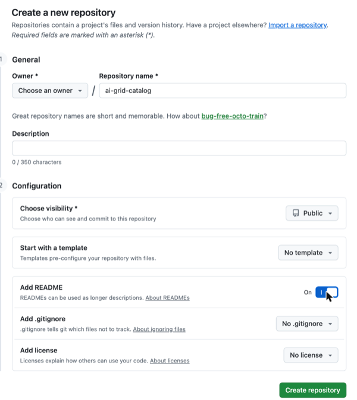
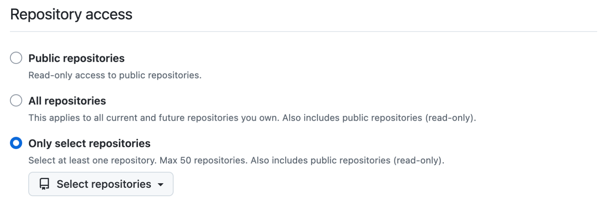
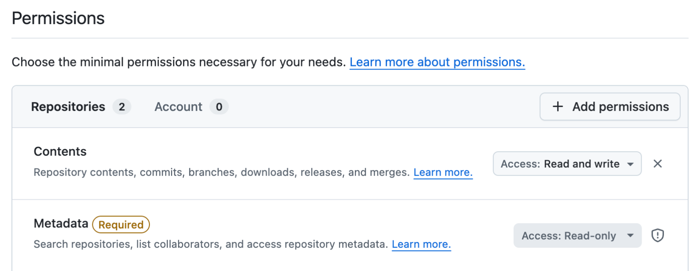

# Install with one command

At the end of this page, `make install` has installed the hub and imported every site into ACM, with no prompt and no
browser, and has written the endpoints a test suite needs to `.install/outputs.json`.

You came here from the README and already created your deployment repository from the template.

## Before you start

You need the following. In step 6, `make prereqs` checks the clusters and logins for you; it doesn't check the
worker nodes or the network.

- [ ] **A hub and one or more sites on OpenShift 4.21 or later,** with nothing of AI Grid on them, and the API URL
  and a `cluster-admin` login for each: a token, or a username and password.
- [ ] **A role in mind for each site:** `combined` (tenants enter and models run), `ingress` (tenants enter, no
  models) or `inference` (models only). At least one site is `ingress` or `combined`. You choose each site's role
  and location after the install, when you add it to the grid in the provider console; `.config/clusters.yaml` has neither.
  <!-- TODO(D11): how the tenant portal's redirect (portalRedirectURI) picks its spoke; open decision. -->
- [ ] **A default StorageClass on each cluster.**
- [ ] **Two worker nodes on each cluster** for Submariner's gateways. On a compact cluster or single-node OpenShift,
  you label the gateway nodes by hand, as [site networking](https://github.com/ai-grid-cloud/ai-grid-cluster-gitops/blob/b96c26578e893a5094b424b0ae55b15a8590c7b7/docs/install/spokes/networking.md) describes.
- [ ] **Network:** each cluster has a load-balancer provider for Submariner's LoadBalancer Service, each cluster
  reaches the other clusters' load balancers on UDP 4500 and 4490, and every router name answers `AAAA` queries
  without `NXDOMAIN`.
- [ ] **A `quay.io/rhoai` robot account:** its username and password. This template installs a pre-release
  OpenShift AI 3.6 build from `quay.io/rhoai`; Red Hat gives `quay.io/rhoai` robot accounts to early-access partners,
  so ask your Red Hat contact.
- [ ] **Tools:** `oc`, `kubectl`, `git`, `jq`, `curl`, `openssl`, `base64`, `python3`, `clusteradm` and `make`. Get
  `clusteradm` from its [releases page](https://github.com/open-cluster-management-io/clusteradm/releases).

## Install

### Set up your deployment repository

Tell the install which clusters and repositories to use, and give it the credentials, in one private file.

1. Clone your deployment repository, by its HTTPS or SSH URL:

   ```sh
   git clone https://github.com/OWNER/DEPLOYMENT_REPO.git deployment && cd deployment
   ```

   Replace `OWNER/DEPLOYMENT_REPO` with your deployment repository. Run every later command from the `deployment`
   directory, on branch `main`. `make install` pushes to this repository with your own git login, the one this
   clone uses, so check that it can push without a prompt; this sends nothing:

   ```sh
   GIT_TERMINAL_PROMPT=0 git push --dry-run origin main
   ```

2. Create `.config/clusters.yaml`, the one file you edit:

   ```sh
   make config
   ```

   It copies `clusters-example.yaml` to `.config/clusters.yaml`, readable only by you, and prints `edit it`. Git
   ignores `.config/`, so the file stays on your machine and can hold your secrets. It never overwrites a file that's
   already there.

3. Open `.config/clusters.yaml` in an editor and fill it in. Each field has a comment that says what it is.

   - **`hub` and `spokes`:** replace each `REQUIRED-` value, and add an entry under `spokes:` for each site, with
     its `name` and `api`. A spoke's name is a DNS label; it becomes the site's ACM cluster name, and you can't
     change it once the site is imported. The hub's name is always `hub`. The file says only how to reach each
     cluster: no role and no location.
   - **`repositories.catalog`:** the URL of the catalog repository you create in step 4, such as
     `https://github.com/my-org/ai-grid-catalog.git`. Pick its owner and name now.
   - **The secrets:** in `hub:` and in each spoke's entry, give a `cluster-admin` `token`, or a `username` and
     `password`. A cluster token usually expires in about 24 hours; with a username and password, the scripts get a
     fresh token on every run, so a rerun the next day works. Fill in `quay:` too. Leave `github:` commented until
     step 5.

   For example:

   ```yaml
   apiVersion: ai-grid.dev/v1alpha1
   kind: Clusters
   hub:
     api: https://api.hub.example.com:6443
     username: kubeadmin
     password: PASSWORD
   spokes:
     - name: site-east-1
       api: https://api.site-east-1.example.com:6443
       token: sha256~TOKEN
     - name: site-east-2
       api: https://api.site-east-2.example.com:6443
       username: kubeadmin
       password: PASSWORD
   repositories:
     catalog: https://github.com/my-org/ai-grid-catalog.git
     library: deployment-template
   quay:
     username: rhoai+robot
     password: PASSWORD
   ```

   A file in the old format, with `sites:`, `credentials:`, `role:` or `location:`, stops with a message that says
   what to change.

   Never paste a secret into a chat, a command line or a file you commit. To enter the secrets at a prompt that
   doesn't show what you paste, instead of editing them, run `make secrets` (`make secrets NAME=github` for the
   GitHub tokens only).

   <!-- TODO(D11): whether make secrets stays, and how it writes the hub's and each spoke's secrets; open decision. -->

### Create the catalog repository and its token

The provider console writes your models and subscriptions to the catalog repository, with a token that can write
that repository and no other.

4. Create your catalog repository, with the owner and name you put in `repositories.catalog`:

   1. Open [Create a new repository](https://github.com/new).
   2. Fill in the form:
      - **Owner:** your account, or the organization that will own the repository
      - **Repository name:** such as `ai-grid-catalog`
      - **Choose visibility:** **Public**
      - **Add README:** **On**
      - **Everything else:** leave it as it is: no template, no `.gitignore` and no license
   3. Click **Create repository**.

   

   With the GitHub CLI instead:

   ```sh
   gh repo create OWNER/CATALOG_REPO --add-readme --public
   ```

   Leave it holding nothing but its README: `make install` stops if it holds anything else.

5. Create the catalog token, and put it in `.config/clusters.yaml`:

   1. Open [New fine-grained personal access token](https://github.com/settings/personal-access-tokens/new). You can
      also reach it from your profile picture: **Settings** > **Developer settings** > **Personal access tokens** >
      **Fine-grained tokens** > **Generate new token**.
   2. Fill in the form:
      - **Token name:** `ai-grid-catalog`
      - **Expiration:** **90 days**, or a later **Custom** date if your organization allows one. When it expires,
        the console can't save models or subscriptions until you replace it, so note the date.
      - **Description:** optional, such as `AI Grid console writes the catalog`
      - **Resource owner:** your account, or the organization that owns your catalog repository. If that
        organization requires approval for fine-grained tokens, the token can only read until an organization owner
        approves it.
      - **Repository access:** **Only select repositories**, then open **Select repositories** and choose your
        catalog repository, and only that one.
      - **Permissions:** on the **Repositories** tab, click **Add permissions**, select **Contents**, and set it to
        **Access: Read and write**. GitHub adds **Metadata: Read-only** itself.
      - **Everything else:** no access. Add no other repository permission and no **Account** permission.

      

      

   3. Click **Generate token** at the bottom of the form.
   4. Copy the token from the page that follows. GitHub shows it only once.
   5. In `.config/clusters.yaml`, uncomment `github:` and its `catalogToken` line, set `catalogToken` to the token,
      and save the file. Leave `deploymentToken` commented: without it, `make install` pushes with your own git
      login.

      ```yaml
      github:
        catalogToken: github_pat_TOKEN
      ```

      Or run `make secrets NAME=github`, leave the deployment token empty, and paste the catalog token at its
      prompt. Either way the token is in `github.catalogToken` in `.config/clusters.yaml`, and nowhere else.

### Check the prerequisites

Confirm that every cluster and credential is ready before anything is installed.

6. Log in to each cluster, then check the prerequisites:

   ```sh
   make login
   make prereqs
   ```

   `make login` writes `.config/NAME/kubeconfig` for each cluster from the cluster's API URL and its credentials in
   `.config/clusters.yaml`. It uses the first of these that it finds:

   1. A working `.config/NAME/kubeconfig`, which it keeps.
   2. The cluster's `token`, in `hub:` or in its entry under `spokes:`.
   3. The cluster's `username` and `password`, in the same place.

   Only for a cluster with none of these does it open your browser to log in, with `oc login --web`. For each cluster
   it prints `Logged in to NAME as USER.` or `NAME: already logged in.` If a cluster's login fails, replace its
   credentials as in step 3, then run `make login` again.

   `make prereqs` prints one line per check, starting with `ok`, `MISSING`, `OLD`, `FAIL` or `skipped`. It checks
   the tools, the `quay.io/rhoai` login, the catalog token, how `make install` pushes this repository (with your
   git login, it reads origin), and, for each cluster in `.config/clusters.yaml`, that it's reachable, runs
   OpenShift 4.21 or later, has a default StorageClass and gives you `cluster-admin`. It changes nothing.

   Fix each `MISSING`, `OLD` or `FAIL` line, then run it again. Everything is ready when it prints no `MISSING`,
   `OLD` or `FAIL` lines.

   If a site had an earlier install, also run `make site-check SITE=SITE_NAME`. It also looks for a previous AI Grid
   install and checks that the site's apps domain resolves.

### Run the install

Run the install and confirm the end state.

7. Run the install:

   ```sh
   make install
   ```

   You don't commit `.config/clusters.yaml`: git ignores it. `make install` commits and pushes the files it
   generates itself, with your git login, or with the deployment token if you set one. On new clusters it takes
   about 75 minutes; waiting for the hub's Applications takes about 55 of them. It prints `== STEP` as each step starts, and ends with:

   ```text
   Installed. Outputs: .install/outputs.json
   ```

   If it stops instead, see [If it stops](#if-it-stops).

8. Check the end state, without changing anything:

   ```sh
   make ready-check
   ```

   It prints one `OK`, `WARN` or `FAIL` line per check, and ends with:

   ```text
   Ready. Outputs: .install/outputs.json
   ```

   A `WARN` line lists the hub Applications that wait for a site to join the grid. They turn healthy after you add
   the first site.

You now have:

- the hub, installed: ACM, Argo CD, Keycloak, the MaaS database, the provider console and monitoring;
- every site imported into the hub's ACM and available, but **not in the grid**: no `ai-grid/` or `location` label
  and no OpenShift AI on it;
- no organizations, models or subscriptions.

## If it stops

When a step fails, `make install` prints why, then stops with a line like the following:

```text
make install stopped at hub-apps. Fix the cause, then run make install again.
```

- If the line names a readiness check, such as `hub-apps` or `site-site-east-1-import`, the evidence is printed
  before it. `.install/report.txt` holds the same evidence: the output of `make status`, of `make site-status` for a
  site, and the conditions of whatever isn't ready.
- If the line names a step, the step's own error is printed before it.
- If it stopped at `ready`, the ready check's last output is in `.install/ready-check.txt`.

`.install/report.txt` can quote your manifests: read it before you share it. For known problems and their fixes, see
[Troubleshooting](troubleshooting.md).

Fix the cause, then run `make install` again. Every step first checks whether its work is done and skips it if so,
so the install picks up where it stopped. On a finished install, a second run changes nothing on the clusters except
a fresh provider-admin token, and passes the ready check again, but only before your tests start. Once a test adds a
site to the grid or creates an organization, model or subscription, the `catalog` step and the ready check's label
and content checks fail by design.

## What the install does

Each step prints `== STEP` as it starts. Before the first one, the install turns the secrets into files under
`.config/generated/`, readable only by you, and passes them to its scripts by path: the catalog token, the
deployment token if you set one, and a `quay.io` auth file built from `quay:`, which the `bootstrap` step uses.

1. `login`: writes `.config/NAME/kubeconfig` for each cluster from its credentials and the API URL in
   `.config/clusters.yaml`.
2. `inputs`: pins the library at `repositories.library`, writes your names to `root/inputs.env`, and pushes.
3. `catalog`: checks that your catalog repository holds only its README.
4. `bootstrap`: installs OpenShift GitOps and applies your root on the hub, then waits until Argo CD has synced it.
5. `acm`: waits until ACM is running.
6. `console-secrets`: creates the provider console's Secrets from your catalog token.
7. `hub-apps`: waits until every hub Application is `Synced` and `Healthy`, except those that wait for a site.
8. `site NAME`: for each site, checks it and imports it into ACM, then waits until it's available.
9. `provider-admin`: creates the provider-admin ServiceAccount and its token.
10. `ready`: runs the ready check until it passes, which writes `.install/outputs.json`.

## Outputs and the provider-admin token

`.install/outputs.json`, which git ignores, has these keys:

| Key | Value |
|---|---|
| `hub.name`, `hub.api` | The hub's name, `hub`, and its API URL |
| `hub.consoleURL` | The provider console |
| `hub.keycloakURL`, `hub.keycloakRealm` | The tenant Keycloak and its realm, `tenants` |
| `hub.persesURL` | Perses's in-cluster URL; it isn't reachable from outside the hub |
| `hub.thanosURL` | The Thanos query Route |
| `hub.lokiStack` | The usage-log LokiStack, `redhat-ods-monitoring/usage-logs` |
| `providerAdminTokenFile` | The path of the provider-admin token file, never the token |
| `library.url`, `library.revision` | The library and the commit you pin |
| `sites[]` | For each site: `name`, `api`, `appsDomain`, and `acmName`, its ManagedCluster's name |

<!-- TODO(D11): the name of the outputs.json key for the spokes (sites or spokes); open decision. -->

The provider-admin token is in `.config/provider-admin-token`. It belongs to ServiceAccount
`ai-grid-test/provider-admin`, which is bound to the console's ClusterRole `ai-grid-provider-admin`, so a test suite
can call the console's API with no browser. Send it as an `Authorization: Bearer` header from a file, never on a
command line. It lasts 168 hours. To get a new one, run `make provider-admin`.

## Add a site to the grid

`make install` leaves each site imported but outside the grid. To add a site, open the provider console
(`hub.consoleURL` in `.install/outputs.json`), click **Clusters**, and click **Add to AI Grid** for the site. Choose
its role and location there. The hub then installs OpenShift AI, MaaS and the grid on the site. To follow it, run
`make site-status SITE=SITE_NAME`.

## Other options

- **A CI job:** a CI job can write `.config/clusters.yaml` itself, or keep the secrets out of it and set them as
  environment variables, which take precedence over the file:

  | Environment variable | Replaces |
  |---|---|
  | `AI_GRID_TOKEN_NAME` | The cluster's `token` |
  | `AI_GRID_USERNAME_NAME`, `AI_GRID_PASSWORD_NAME` | The cluster's `username` and `password` |
  | `AI_GRID_DEPLOYMENT_TOKEN`, else the file that `DEPLOYMENT_TOKEN_FILE` names | `github.deploymentToken` |
  | `AI_GRID_CATALOG_TOKEN`, else the file that `CATALOG_TOKEN_FILE` names | `github.catalogToken` |
  | `AI_GRID_QUAY_USERNAME`, `AI_GRID_QUAY_PASSWORD`, else the auth file that `QUAY_AUTH_FILE` names | `quay.username`, `quay.password` |

  For each GitHub token and the `quay.io` login, the scripts use the first that's set: the `AI_GRID_` variable, the
  file that the `*_FILE` variable names, the value in `.config/clusters.yaml`, then an older secret file,
  `.config/deployment-token`, `.config/catalog-token` or `.config/quay-auth.json`. For a cluster's login, they use a
  working `.config/NAME/kubeconfig`, then a token (`AI_GRID_TOKEN_NAME`, then
  the file), then a username and password (the `AI_GRID_` variables, then the file).

  In a variable's name, `NAME` is the cluster's name upper-cased with `-` turned into `_`, such as
  `AI_GRID_TOKEN_SITE_EAST_1`. A setting that the file leaves out of `options:` comes from the environment variable
  of the same name. To make `make login` fail instead of opening a browser for a cluster with no credentials, run
  `make login NONINTERACTIVE=1`; `make install` never opens a browser.
- **A deployment token, for CI or an unattended run:** by default `make install` pushes your deployment repository
  with your own git login. Where there's none, such as a CI job, set `github.deploymentToken` in
  `.config/clusters.yaml`, or `AI_GRID_DEPLOYMENT_TOKEN`, to a fine-grained token with the same fields as the
  catalog token in step 5, except **Token name** `ai-grid-deployment` and **Repository access** your deployment
  repository only. With a token, `make install` uses only the token and skips your git credential helpers.
- **A login you already have:** copy a working kubeconfig, such as the installer's `auth/kubeconfig`, to
  `.config/NAME/kubeconfig`. `make install` keeps a login that works.
- **An untrusted cluster certificate:** put the CAs the cluster's certificates chain to in `.config/NAME/ca.crt`, as
  PEM. With a username and password, the login also reaches the cluster's OAuth server, which the ingress router
  serves, and checks it against the same file, so the file holds both the API's CA and the router's CA. To build it
  with the installer's `auth/kubeconfig`:

  ```sh
  # The API's CA, from the installer's kubeconfig
  oc config view --kubeconfig auth/kubeconfig --raw \
    -o jsonpath='{.clusters[0].cluster.certificate-authority-data}' | base64 -d > api-ca.crt
  # The router's CA
  oc get secret router-ca -n openshift-ingress-operator --kubeconfig auth/kubeconfig \
    -o jsonpath='{.data.tls\.crt}' | base64 -d > router-ca.crt
  mkdir -p .config/NAME && cat api-ca.crt router-ca.crt > .config/NAME/ca.crt
  ```

  Without the installer's kubeconfig, run the `router-ca` command with any working `cluster-admin` login, and save
  the last certificate that `openssl s_client -showcerts -connect api.CLUSTER_DOMAIN:6443 </dev/null` prints as
  `api-ca.crt`. If the router serves a custom certificate, use the CA that issued it instead of `router-ca`.
- **A general `quay.io` account:** put its name and password under `quay:`. The install uses it for `quay.io/rhoai`
  as it would a robot account, so it works only when that account can pull from `quay.io/rhoai`.
- **Another library revision:** set `repositories.library` to a branch, tag or commit, or leave it empty to keep the
  template's own commit pin.
- **Another token lifetime:** set `PROVIDER_ADMIN_TOKEN_DURATION` under `options:` for `make install`, or in the
  environment for `make provider-admin`.
- **Longer or shorter waits:** each `GATE_*_SECONDS` value under `options:` sets a readiness check's time limit, in
  seconds. The hub's Applications get 90 minutes (`GATE_HUB_APPS_SECONDS: 5400`).
- **The hub alone,** without the sites, the provider-admin token or the ready check:

  ```sh
  make install HUB_ONLY=1
  ```

## Known limits

- The MaaS gateway uses the cluster's internal certificate, so tenants' clients don't trust it until you add your own
  certificate.
- `make install` always installs its own Keycloak. Using an existing one, with `KEYCLOAK` under `options:`, comes
  later; any value but `install` stops the install.
- Starting over means new clusters, and new deployment and catalog repositories. `make install` doesn't uninstall;
  to remove AI Grid from clusters, see [Uninstall](08-uninstall.md).
